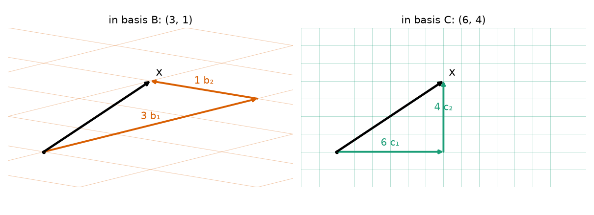
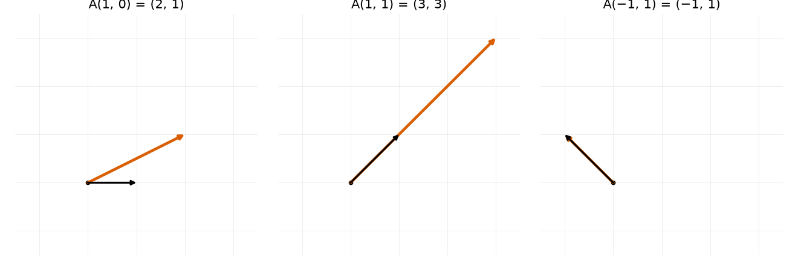

Cover the right-hand column.
Answer each question in your head, then look.

## The numbers are a recipe

|                                         |                                  |
|:----------------------------------------|:---------------------------------|
| What is (6, 4)? | Two numbers. |
| Is it an arrow? | Not yet. It's what we write down for one. |
| What do the numbers say? | Walk 6 steps along one arrow, then 4 along another. |
| What are those two arrows called? | The **basis**. Think of them as ingredients. |
| And (6, 4)? | The **recipe**: how much of each ingredient. |



|                                         |                                  |
|:----------------------------------------|:---------------------------------|
| On the right, what are the ingredients? | c₁, one step right, and c₂, one step up. |
| What is the recipe for x? | (6, 4). |
| On the left, what are the ingredients? | b₁ = (4, 1) and b₂ = (−6, 1). |
| What is the recipe for x? | (3, 1). Three of b₁ goes far right; one of b₂ comes back. |
| Two pictures, two recipes. How many arrows? | One. The arrow didn't move. |
| Then what changed? | The ingredients, and so the recipe. |

The recipe is a picture.
Here are the official words,
the ones Lay uses (4.4) [[Lay16]](#references):

- b₁ and b₂ are the **basis vectors** of a **basis**, called B;
- the recipe (3, 1) is the **coordinates of x relative to B**, written $[x]_B$;
- c₁ and c₂, the usual grid, are the **standard basis**.

From here on, we use those words.

Drag the tips of b₁ and b₂.
The black arrow x stays where it is.

```{ojs}
//| echo: false
x = [6, 4]
B1 = "#7570b3"   // b₁ and everything made of it (purple)
B2 = "#d95f02"   // b₂ and everything made of it (orange)

viewof basis = {
  const X0 = -8, X1 = 14, Y0 = -4, Y1 = 9, S = 26;      // S px per unit
  const W = (X1 - X0) * S, H = (Y1 - Y0) * S;
  const px = p => [(p[0] - X0) * S, (Y1 - p[1]) * S];
  const fromPx = (u, v) => [Math.round(u / S + X0), Math.round(Y1 - v / S)];
  const state = {b1: [4, 1], b2: [-6, 1]};
  const svg = d3.create("svg").attr("viewBox", `0 0 ${W} ${H}`)
    .style("width", "100%").style("max-width", `${W}px`)
    .style("touch-action", "none");
  const defs = svg.append("defs");
  for (const [id, color] of [["t1", B1], ["t2", B2], ["tk", "black"]])
    defs.append("marker").attr("id", id).attr("viewBox", "0 0 10 10")
      .attr("refX", 9).attr("refY", 5).attr("markerWidth", 5)
      .attr("markerHeight", 5).attr("orient", "auto")
      .append("path").attr("d", "M0,0L10,5L0,10z").attr("fill", color);
  const g = svg.append("g");
  const node = svg.node();

  function arrow(p, q, color, width, tip, opacity = 1) {
    const [a, b] = [px(p), px(q)];
    g.append("line").attr("x1", a[0]).attr("y1", a[1]).attr("x2", b[0])
      .attr("y2", b[1]).attr("stroke", color).attr("stroke-width", width)
      .attr("stroke-opacity", opacity)
      .attr("marker-end", tip ? `url(#${tip})` : null);
  }
  function label(p, text, color) {
    const [a, b] = px(p);
    g.append("text").attr("x", a[0] + 10).attr("y", b - 10)
      .attr("fill", color).attr("font-size", 17).text(text);
  }
  function draw() {
    g.selectAll("*").remove();
    const {b1, b2} = state;
    const det = b1[0] * b2[1] - b2[0] * b1[1];
    if (det !== 0) {                    // the grid the ingredients make
      for (let k = -40; k <= 40; k++)
        for (const [d, o] of [[b1, b2], [b2, b1]])
          arrow([k * o[0] - 60 * d[0], k * o[1] - 60 * d[1]],
                [k * o[0] + 60 * d[0], k * o[1] + 60 * d[1]],
                "#999", 0.7, null, 0.3);
      const r1 = (x[0] * b2[1] - b2[0] * x[1]) / det;  // walk the recipe:
      const mid = [r1 * b1[0], r1 * b1[1]];            // so much b₁,
      arrow([0, 0], mid, B1, 2.5, "t1", 0.6);
      arrow(mid, x, B2, 2.5, "t2", 0.6);               // then b₂
    }
    arrow([0, 0], x, "black", 3.5, "tk");
    arrow([0, 0], b1, B1, 5, "t1");
    arrow([0, 0], b2, B2, 5, "t2");
    for (const [p, name, color] of [[b1, "b₁", B1], [b2, "b₂", B2]]) {
      const [a, b] = px(p);
      g.append("circle").attr("cx", a[0]).attr("cy", b).attr("r", 9)
        .attr("fill", color).attr("fill-opacity", 0.3)
        .style("cursor", "grab");
      label(p, name, color);
    }
    label(x, "x", "black");
    node.value = {b1: [...b1], b2: [...b2]};
    node.dispatchEvent(new Event("input", {bubbles: true}));
  }

  let dragging = null;
  const local = e => {
    const r = node.getBoundingClientRect();
    return [(e.clientX - r.left) * W / r.width, (e.clientY - r.top) * H / r.height];
  };
  node.addEventListener("pointerdown", e => {
    const [u, v] = local(e);
    const dist = k => Math.hypot(px(state[k])[0] - u, px(state[k])[1] - v);
    const k = dist("b1") < dist("b2") ? "b1" : "b2";
    if (dist(k) < 24) { dragging = k; node.setPointerCapture(e.pointerId); }
  });
  node.addEventListener("pointermove", e => {
    if (!dragging) return;
    const p = fromPx(...local(e));
    if (p[0] === 0 && p[1] === 0) return;           // no zero ingredient
    if (p[0] !== state[dragging][0] || p[1] !== state[dragging][1]) {
      state[dragging] = p; draw();
    }
  });
  node.addEventListener("pointerup", () => { dragging = null; });
  draw();
  return node;
}
```

```{ojs}
//| echo: false
// The recipe, written with each ingredient as a column in its colour:
//   x = r1·(b1) + r2·(b2)
// Part 1's dictionary section points back here: these columns are P.
{
  const {b1, b2} = basis;
  const det = b1[0] * b2[1] - b2[0] * b1[1];
  if (det === 0) return md`b₁ and b₂ lie along one line.
No mix of them reaches x.`;
  const r1 = (x[0] * b2[1] - b2[0] * x[1]) / det;
  const r2 = (b1[0] * x[1] - x[0] * b1[1]) / det;
  const f = n => Number.isInteger(n) ? `${n}` : n.toFixed(2);
  const col = (v, color) => html`<span style="display:inline-flex;
    flex-direction:column; align-items:flex-end; vertical-align:middle;
    border-left:2px solid ${color}; border-right:2px solid ${color};
    border-radius:.8em; padding:0 .45em; margin:0 .2em; color:${color}; font-weight:600">
    <span>${f(v[0])}</span><span>${f(v[1])}</span></span>`;
  const sum = [r1 * b1[0] + r2 * b2[0], r1 * b1[1] + r2 * b2[1]];
  return html`<div style="font-size:1.3em; font-family:monospace">
    x = <span style="color:${B1}">${f(r1)}</span>·${col(b1, B1)}
    + <span style="color:${B2}">${f(r2)}</span>·${col(b2, B2)}
    = ${col(sum, "black")}</div>
    <p>The coordinates of x in this basis are
    (<span style="color:${B1}">${f(r1)}</span>,
     <span style="color:${B2}">${f(r2)}</span>).</p>`;
}
```

|                                         |                                  |
|:----------------------------------------|:---------------------------------|
| Put b₁ back at (4, 1) and drag only b₂. Does x's amount of b₁ change? | Yes, though b₁ never moved. Odd. Part 3 explains it. |

::: {.callout-note appearance="simple"}
## The Law of Coordinates

A vector's numbers are its coordinates in some basis.
Change the basis, and the coordinates change.
The arrow does not.
:::

## The dictionary

You've been dragging b₁ and b₂ wherever you like.
Now let's fix one example and work it by hand.
If you moved them, put them back where they started:

- the old basis B is **b₁ = (4, 1)** and **b₂ = (−6, 1)**;
- the new basis C is the usual grid,
  **c₁** one step right and **c₂** one step up;
- the arrow is **x**, whose coordinates in B are $[x]_B = (3, 1)$.

The question: what are x's coordinates in C, $[x]_C$?

|                                         |                                  |
|:----------------------------------------|:---------------------------------|
| How do we turn $[x]_B = (3, 1)$ into $[x]_C = (6, 4)$ without drawing? | Look up each basis vector of B in c-words, like words in a dictionary. |
| What is b₁, in c-words? | 4c₁ + c₂, or the column (4, 1). |
| And b₂? | −6c₁ + c₂, or the column (−6, 1). |
| So what is 3b₁ + b₂? | 3(4c₁ + c₂) + (−6c₁ + c₂) = 6c₁ + 4c₂. Coordinates (6, 4). |
| Where is the matrix? | Push the two columns together. |

$$
P = \begin{pmatrix} {\color{#7570B3}4} & {\color{#D95F02}-6} \\ {\color{#7570B3}1} & {\color{#D95F02}1} \end{pmatrix}
$$

Column 1 is b₁; column 2 is b₂.

|                                         |                                  |
|:----------------------------------------|:---------------------------------|
| What is P(3, 1)? | 3 of column 1, plus 1 of column 2: (6, 4). |
| Where have we seen that? | In the coloured line under the drag picture. Drag b₁, and column 1 changes with it. |
| So what is P? | A dictionary. Each column is one basis vector of B, looked up in C: $[b_1]_C$ and $[b_2]_C$. |
| What does Lay call it? | The **change-of-coordinates matrix** from B to C, $P_{C\leftarrow B}$, with $[x]_C = P_{C\leftarrow B}\,[x]_B$ (4.7). |

::: {.callout-note appearance="simple"}
## The Law of Change of Coordinates

To change coordinates from B to C,
write each vector of B in C's coordinates.
Those are the columns of $P_{C\leftarrow B}$.
:::

|                                         |                                  |
|:----------------------------------------|:---------------------------------|
| A friend writes $P_{C\leftarrow B}$ with its columns as rows: $\begin{pmatrix} 4 & 1 \\ -6 & 1 \end{pmatrix}$. What do they get for (3, 1)? | (13, −17). |
| Is that x? | No. x is (6, 4). |
| What went wrong? | Each row mixes parts of b₁ and b₂. A column holds one whole basis vector. |

To check your understanding, here is Lay's 4.4, Example 1.
The basis is b₁ = (1, 0) and b₂ = (1, 2), and $[x]_B = (-2, 3)$.
What is x?
Decide before you read on.

|                                         |                                  |
|:----------------------------------------|:---------------------------------|
| What is −2·b₁ + 3·b₂? | −2·(1, 0) + 3·(1, 2) = (1, 6). |

## Why anyone bothers

$$
A = \begin{pmatrix} 2 & 1 \\ 1 & 2 \end{pmatrix}
$$

|                                         |                                  |
|:----------------------------------------|:---------------------------------|
| Where does A send (1, 0)? | To (2, 1). Stretched and turned. |
| Where does A send (1, 1)? | To (3, 3). |
| Turned? | No. Same direction, three times as long. |
| And (−1, 1)? | To (−1, 1). It doesn't move at all. |



|                                         |                                  |
|:----------------------------------------|:---------------------------------|
| Along (1, 1) and (−1, 1), what does A do? | Only stretches: by 3, and by 1. |
| If those were our basis, what would A do to coordinates? | Multiply the first by 3 and leave the second alone: the matrix (3 0; 0 1). Same A, new matrix, as simple as a matrix gets. |
| How do we find such a basis? | That is part 2. |

## In Lay

| Here | Lay |
|:-----|:----|
| ingredients b₁, b₂ | basis vectors of a basis B (4.3) |
| recipe (3, 1) | coordinates of x relative to B, $[x]_B$ (4.4) |
| the usual grid | the standard basis (4.4) |
| the dictionary P | change-of-coordinates matrix $P_{C\leftarrow B}$ (4.7); $P_B$ when C is standard (4.4) |
| our worked example | 4.7, Example 1 |

## References

**[Lay16]** D. C. Lay, S. R. Lay, J. J. McDonald,
*Linear Algebra and Its Applications*, 5th ed., Pearson, 2016.
The Math 54 text at UC Berkeley.
Section and example numbers in this series follow this edition.
This series is not affiliated with UC Berkeley or the publisher.
