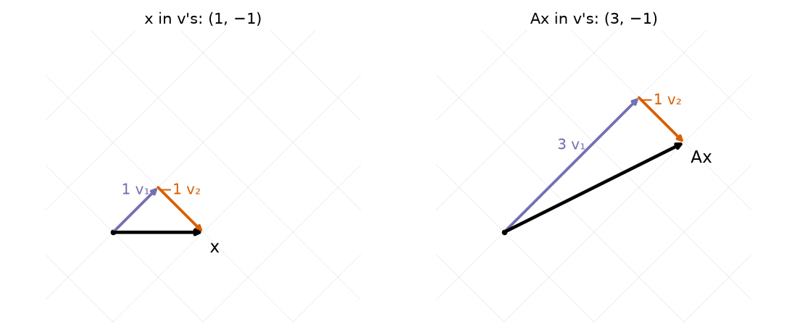
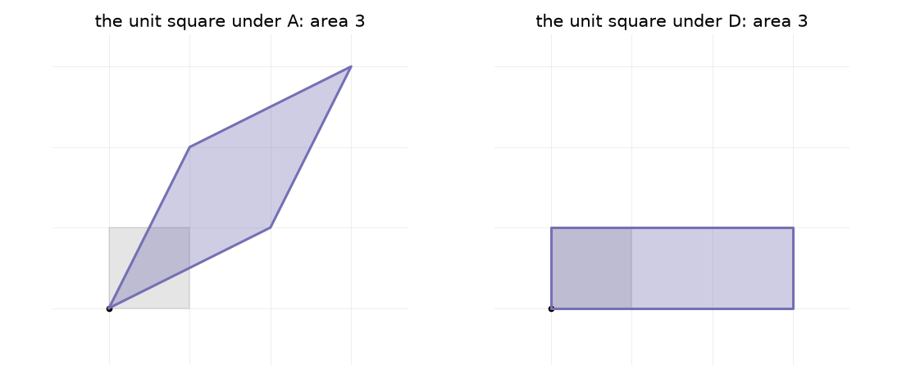

Cover the right-hand column.
Answer each question in your head, then look.

Part 1 ended with a matrix that turns most arrows
but leaves two directions alone:

$$
A = \begin{pmatrix} 2 & 1 \\ 1 & 2 \end{pmatrix}
$$

This part uses those two directions as the basis.

## Arrows that don't turn

Drag the tip of v.
The orange arrow is Av, where A sends it.

```{ojs}
//| echo: false
A = [[2, 1], [1, 2]]
apply = (M, p) => [M[0][0] * p[0] + M[0][1] * p[1],
                   M[1][0] * p[0] + M[1][1] * p[1]]

viewof v = {
  const X0 = -7, X1 = 7, Y0 = -7, Y1 = 7, S = 26;       // S px per unit
  const W = (X1 - X0) * S, H = (Y1 - Y0) * S;
  const px = p => [(p[0] - X0) * S, (Y1 - p[1]) * S];
  const fromPx = (u, w) => [Math.round(u / S + X0), Math.round(Y1 - w / S)];
  let state = [1, 0];
  const svg = d3.create("svg").attr("viewBox", `0 0 ${W} ${H}`)
    .style("width", "100%").style("max-width", `${W}px`)
    .style("touch-action", "none");
  const defs = svg.append("defs");
  for (const [id, color] of [["v2t1", "#7570b3"], ["v2t2", "#d95f02"]])
    defs.append("marker").attr("id", id).attr("viewBox", "0 0 10 10")
      .attr("refX", 9).attr("refY", 5).attr("markerWidth", 5)
      .attr("markerHeight", 5).attr("orient", "auto")
      .append("path").attr("d", "M0,0L10,5L0,10z").attr("fill", color);
  const g = svg.append("g");
  const node = svg.node();
  function arrow(p, q, color, width, tip, opacity = 1) {
    const [a, b] = [px(p), px(q)];
    g.append("line").attr("x1", a[0]).attr("y1", a[1]).attr("x2", b[0])
      .attr("y2", b[1]).attr("stroke", color).attr("stroke-width", width)
      .attr("stroke-opacity", opacity)
      .attr("marker-end", tip ? `url(#${tip})` : null);
  }
  function draw() {
    g.selectAll("*").remove();
    for (let k = X0; k <= X1; k++) {                    // plain grid
      arrow([k, Y0], [k, Y1], "#999", 0.7, null, 0.25);
      arrow([X0, k], [X1, k], "#999", 0.7, null, 0.25);
    }
    const Av = apply(A, state);
    const own = state[0] * Av[1] - state[1] * Av[0] === 0;
    if (own)                                            // its own line
      arrow([-20 * state[0], -20 * state[1]], [20 * state[0], 20 * state[1]],
            "#7570b3", 2, null, 0.35);
    arrow([0, 0], Av, "#d95f02", 4, "v2t2");
    arrow([0, 0], state, "#7570b3", 5, "v2t1");
    const [a, b] = px(state);
    g.append("circle").attr("cx", a).attr("cy", b).attr("r", 9)
      .attr("fill", "#7570b3").attr("fill-opacity", 0.3)
      .style("cursor", "grab");
    g.append("text").attr("x", a + 10).attr("y", b - 10)
      .attr("fill", "#7570b3").attr("font-size", 17).text("v");
    const [c, d] = px(Av);
    g.append("text").attr("x", c + 10).attr("y", d - 10)
      .attr("fill", "#d95f02").attr("font-size", 17).text("Av");
    node.value = [...state];
    node.dispatchEvent(new Event("input", {bubbles: true}));
  }
  let dragging = false;
  const local = e => {
    const r = node.getBoundingClientRect();
    return [(e.clientX - r.left) * W / r.width, (e.clientY - r.top) * H / r.height];
  };
  node.addEventListener("pointerdown", e => {
    const [u, w] = local(e);
    const [a, b] = px(state);
    if (Math.hypot(a - u, b - w) < 24) {
      dragging = true; node.setPointerCapture(e.pointerId);
    }
  });
  node.addEventListener("pointermove", e => {
    if (!dragging) return;
    const p = fromPx(...local(e));
    if (p[0] === 0 && p[1] === 0) return;
    if (Math.abs(p[0]) > 3 || Math.abs(p[1]) > 3) return; // keep Av on screen
    if (p[0] !== state[0] || p[1] !== state[1]) { state = p; draw(); }
  });
  node.addEventListener("pointerup", () => { dragging = false; });
  draw();
  return node;
}
```

```{ojs}
//| echo: false
{
  const Av = apply(A, v);
  const own = v[0] * Av[1] - v[1] * Av[0] === 0;
  const k = (Av[0] * v[0] + Av[1] * v[1]) / (v[0] * v[0] + v[1] * v[1]);
  return html`<div style="font-size:1.2em; font-family:monospace">
    v = (${v[0]}, ${v[1]}) &nbsp;→&nbsp; Av = (${Av[0]}, ${Av[1]})</div>
    <p>${own
      ? html`<b>Av = ${k}·v.</b> A doesn't turn this arrow; it only stretches it, by ${k}.`
      : "A turned this arrow."}</p>`;
}
```

|                                         |                                  |
|:----------------------------------------|:---------------------------------|
| Drag v around. Does Av usually point the same way as v? | No. A turns most arrows. |
| Which arrows does it not turn? | Those along (1, 1), and those along (−1, 1). |
| What does it do to them? | Stretches them: by 3 along (1, 1), by 1 along (−1, 1). |
| What are they called? | **Eigenvectors**. *Eigen* is German for "own": each is A's own arrow, keeping to its own line. Think "own arrow". |
| And the 3 and the 1? | **Eigenvalues**: how much each one stretches. |

To check your understanding, here is the matrix Lay opens 5.1 with (Example 1):

$$
\begin{pmatrix} 3 & -2 \\ 1 & 0 \end{pmatrix}
$$

|                                         |                                  |
|:----------------------------------------|:---------------------------------|
| Where does it send v = (2, 1)? | To (4, 2) = 2v. An eigenvector, with eigenvalue 2. Lay's words: it only "stretches" v. |
| And u = (−1, 1)? | To (−5, −1). Turned: not an eigenvector. |

## What does A do to x?

Call the two eigenvectors **v₁ = (1, 1)** and **v₂ = (−1, 1)**,
and take one arrow to work with,
**x = (2, 0)**: its coordinates in the standard basis.

Where does A send x?
We could multiply A by x.
Instead we'll take three easy steps.

**Step 1. Translate x into v's.**

|                                         |                                  |
|:----------------------------------------|:---------------------------------|
| What are x's coordinates in v's? | (1, −1), because 1·v₁ − 1·v₂ = (1, 1) − (−1, 1) = (2, 0). |

**Step 2. Stretch.**

|                                         |                                  |
|:----------------------------------------|:---------------------------------|
| What does A do to v₁? | Stretches it by 3. |
| And to v₂? | Leaves it as it is: a stretch by 1. |
| So what are Ax's coordinates in v's? | (3·1, 1·(−1)) = (3, −1). |

**Step 3. Translate back into the usual grid.**

|                                         |                                  |
|:----------------------------------------|:---------------------------------|
| What is (3, −1) in v's, in the usual grid? | 3·v₁ − 1·v₂ = (3, 3) − (−1, 1) = (4, 2). |
| Check the long way: what is A(2, 0)? | (2·2 + 1·0, 1·2 + 2·0) = (4, 2). The same. |



## Naming the steps

We did the three steps with numbers.
Each one is also a matrix.
Name them, and A fits on one line.

|                                         |                                  |
|:----------------------------------------|:---------------------------------|
| Step 3 translates from v's into the usual grid. Have we met that? | Yes: part 1's change-of-coordinates matrix, P. Its columns are v₁ and v₂. |
| Step 1 goes the other way. What is it? | P undone. Call it **P⁻¹**. |

$$
P^{-1} = \begin{pmatrix} \tfrac12 & \tfrac12 \\ -\tfrac12 & \tfrac12 \end{pmatrix}\qquad
P^{-1}\begin{pmatrix} 2 \\ 0 \end{pmatrix} = \begin{pmatrix} \tfrac12\cdot 2 + \tfrac12\cdot 0 \\ -\tfrac12\cdot 2 + \tfrac12\cdot 0 \end{pmatrix} = \begin{pmatrix} 1 \\ -1 \end{pmatrix}
$$

|                                         |                                  |
|:----------------------------------------|:---------------------------------|
| Does it undo P? | Yes. P⁻¹ takes (2, 0) to (1, −1), and P takes (1, −1) back to (2, 0). |
| Why the −1? | As 3⁻¹ = ⅓ undoes multiplying by 3. Say "P inverse". |
| Step 2 only stretches. What is it? | **D**, a matrix with the eigenvalues on its diagonal and zeros elsewhere: a **diagonal matrix**. |

$$
P = \begin{pmatrix} {\color{#7570B3}1} & {\color{#D95F02}-1} \\ {\color{#7570B3}1} & {\color{#D95F02}1} \end{pmatrix}\qquad
D = \begin{pmatrix} 3 & 0 \\ 0 & 1 \end{pmatrix}\qquad
A = P\,D\,P^{-1}
$$

|                                         |                                  |
|:----------------------------------------|:---------------------------------|
| Why is P⁻¹ on the right, when it's step 1? | A matrix acts on what's to its right, so P D P⁻¹ x is read right to left: P⁻¹ first, P last. |

Writing A = P D P⁻¹ is called **diagonalizing** A (Lay 5.3).

::: {.callout-note appearance="simple"}
## The Law of Stretching

Use a matrix's eigenvectors as the basis,
and the matrix only stretches.
A = P D P⁻¹: find the coordinates, stretch them, change back.
:::

## Why anyone bothers

|                                         |                                  |
|:----------------------------------------|:---------------------------------|
| What is A applied ten times to x? | Ten matrix multiplications, if done the long way. |
| And in v's? | Stretch the coordinates ten times: (3¹⁰·1, 1¹⁰·(−1)) = (59049, −1). |
| So what is A¹⁰x? | 59049·(1, 1) − 1·(−1, 1) = (59050, 59048). |
| How much work was that? | One look-up, one power of each number, one translation back. |

Lay's 5.3, Example 2 does the same with another matrix:

$$
\begin{pmatrix} 7 & 2 \\ -4 & 1 \end{pmatrix} = P\,D\,P^{-1}\qquad
P = \begin{pmatrix} 1 & 1 \\ -1 & -2 \end{pmatrix}\qquad
D = \begin{pmatrix} 5 & 0 \\ 0 & 3 \end{pmatrix}
$$

|                                         |                                  |
|:----------------------------------------|:---------------------------------|
| What is its k-th power? | P Dᵏ P⁻¹. Only the 5ᵏ and the 3ᵏ change. |

## Same map, new matrix

Part 1 changed the basis and kept the arrow.
Now we change the basis and keep the map.

|                                         |                                  |
|:----------------------------------------|:---------------------------------|
| In the usual grid, A's matrix is (2 1; 1 2). In v's, what is it? | D = (3 0; 0 1). In v's, A only stretches. |
| Are A and D two different maps? | No. One map, written in two bases. Lay calls such matrices **similar**. |
| What changed between them? | The entries. |
| What didn't? | What belongs to the map itself: the eigenvalues, 3 and 1, for a start. |

One more number belongs to the map: how much it scales area.



|                                         |                                  |
|:----------------------------------------|:---------------------------------|
| What does A do to the unit square? | Makes the parallelogram on (2, 1) and (1, 2), of area 2·2 − 1·1 = 3. |
| And D? | Makes a 3 × 1 rectangle: area 3. The same, because it's the same map. |
| What is that number called? | The **determinant**. For (a b; c d), det = ad − bc. |

To check your understanding:
a friend says A's eigenvalues are its diagonal entries, 2 and 2.
Are they right?
Decide before you read on.

|                                         |                                  |
|:----------------------------------------|:---------------------------------|
| Is 2 an eigenvalue of A? | No. A's eigenvalues are 3 and 1. |
| When are the diagonal entries the eigenvalues? | When the matrix is diagonal, like D. Entries depend on the basis; eigenvalues don't. |

::: {.callout-note appearance="simple"}
## The Law of Invariance

A change of basis changes a matrix's entries, not the map.
What belongs to the map survives it:
its eigenvalues, and its determinant.
:::

## Finding the eigenvalues yourself

So far, 3 and 1 were handed to you.
Here is where they come from.
I is the **identity**, (1 0; 0 1), the matrix that changes nothing.

|                                         |                                  |
|:----------------------------------------|:---------------------------------|
| If v is an eigenvector with eigenvalue λ, what does A − λI do to v? | Av − λv = λv − λv = 0. It flattens v to 0. |
| A matrix that flattens an arrow to 0 squashes the square onto a line. What area is left? | 0. So det(A − λI) = 0. |
| For our A, what is A − λI? | (2−λ 1; 1 2−λ), so det(A − λI) = (2 − λ)² − 1. |
| When is (2 − λ)² − 1 = 0? | When 2 − λ = 1 or −1: λ = 1 or λ = 3. |
| Check λ = 3. | A − 3I = (−1 1; 1 −1) sends (1, 1) to (0, 0): the eigenvector, flattened. |

det(A − λI) = 0 is Lay's **characteristic equation** (5.2).

## Not every matrix is so kind

$$
S = \begin{pmatrix} 1 & 1 \\ 0 & 1 \end{pmatrix}
$$

|                                         |                                  |
|:----------------------------------------|:---------------------------------|
| What is S(1, 0)? | (1, 0). Not turned. |
| What is S(0, 1)? | (1, 1). Turned. |
| Which arrows does S not turn? | Only those along (1, 0). One line. |
| How many basis vectors does a flat page need? | Two. |
| So can we write S = P D P⁻¹? | No. There aren't enough eigenvectors. |
| Look back at A's v₁ = (1, 1) and v₂ = (−1, 1). Notice anything? | They are perpendicular. |
| Is that luck? | No. A is symmetric: it is its own mirror across the diagonal. That is part 3. |
| And what about S? | Use two different bases, one for the arrow going in and one for the arrow coming out. That is SVD, part 4. |

## In Lay

Section and example numbers from [[Lay16]](linalg1-same-arrow.qmd#references).

| Here | Lay |
|:-----|:----|
| own arrows | eigenvectors (5.1) |
| how much each stretches | eigenvalues (5.1) |
| A = P D P⁻¹ | diagonalization; the Diagonalization Theorem (5.3) |
| A¹⁰x by stretching | powers, Aᵏ = P Dᵏ P⁻¹ (5.3) |
| P⁻¹ | the inverse matrix (2.2) |
| S has too few eigenvectors | S is not diagonalizable (5.3) |
| A and D: one map, two matrices | similar matrices; same eigenvalues, 5.2 Theorem 4 |
| area scale, ad − bc | the determinant; area = \|det A\|, 3.3 Theorem 9 |
| det(A − λI) = 0 | the characteristic equation (5.2) |
