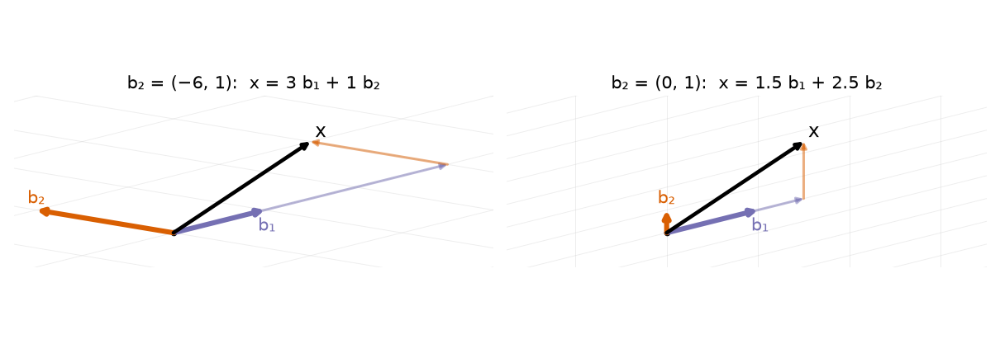
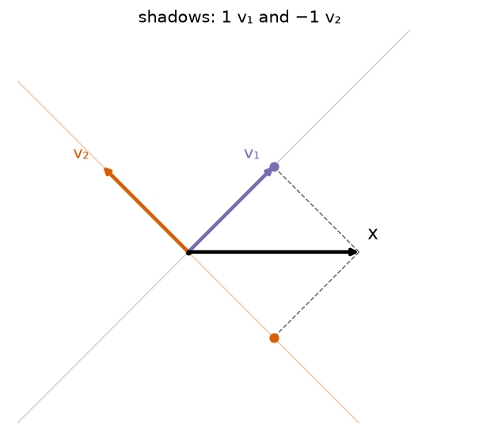
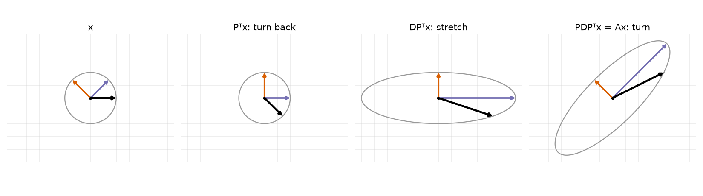
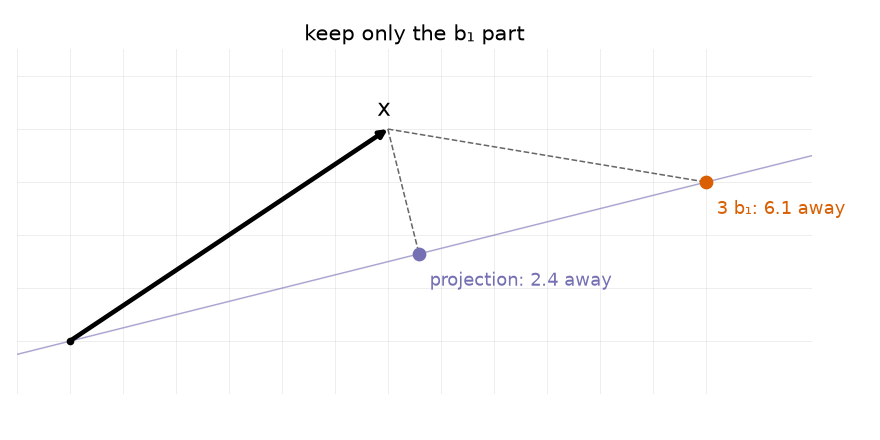

Cover the right-hand column.
Answer each question in your head, then look.

Part 2 found A's two eigenvectors:

$$
A = \begin{pmatrix} 2 & 1 \\ 1 & 2 \end{pmatrix}\qquad
v_1 = (1, 1),\ \text{eigenvalue } 3\qquad
v_2 = (-1, 1),\ \text{eigenvalue } 1
$$

It ended with a hint: they are perpendicular.
This part is about why that matters.
In a perpendicular basis, a coordinate stops being a bookkeeping
number and becomes a measurement.

## A coordinate that depends on its neighbours



|                                         |                                  |
|:----------------------------------------|:---------------------------------|
| Both pictures have the same x = (6, 4) and the same b₁ = (4, 1). What changed? | Only b₂: (−6, 1) on the left, (0, 1) on the right. |
| How much b₁ is in x, on the left? | 3, part 1's coordinates: x = 3b₁ + b₂. |
| And on the right? | 1.5: 1.5·(4, 1) + 2.5·(0, 1) = (6, 4). |
| b₁ didn't move. Why did its coordinate change? | Coordinates are found together, by solving a·b₁ + b·b₂ = x. Move b₂, and a must change to make up for it. |
| So is "how much b₁ is in x" a question about x and b₁? | No. It's a question about the whole basis. |
| Can a coordinate depend only on x and its own direction? | Yes, when the basis vectors are perpendicular. |

Solving like this is how Lay finds coordinates in 4.4, Example 4:
b₁ = (2, 1), b₂ = (−1, 1), x = (4, 5);
2a − b = 4 and a + b = 5 give $[x]_B = (3, 2)$.
Those b's aren't perpendicular, so solving was the only way.

## Shadows



|                                         |                                  |
|:----------------------------------------|:---------------------------------|
| Take x = (2, 0). Drop a line from x's tip straight onto v₁'s line, at a right angle. Where does it land? | At (1, 1). That is 1·v₁. |
| And straight onto v₂'s line? | At (1, −1). That is −1·v₂. |
| Are (1, −1) x's coordinates in v's? | Yes: 1·(1, 1) − 1·(−1, 1) = (2, 0). |
| Why did dropping a line work? | x is made of some v₁ and some v₂. The v₂ part is perpendicular to v₁'s line, so it adds nothing there. |
| What is that landing point called? | x's **shadow** on the line. |

The shadow is a picture.
Here are the official words,
the ones Lay uses (6.1–6.2):

- the shadow is the **orthogonal projection** of x onto v₁'s line;
- **orthogonal** is the mathematician's word for perpendicular.

From here on, we say projection and orthogonal.

To find a projection without drawing, use the **dot product**
(Lay also calls it the **inner product**):
multiply matching numbers and add.

$$
x \cdot v = x_1 v_1 + x_2 v_2
$$

|                                         |                                  |
|:----------------------------------------|:---------------------------------|
| What is x·v₁? | (2, 0)·(1, 1) = 2·1 + 0·1 = 2. |
| And v₁·v₁? | 1 + 1 = 2. |
| How much v₁ is in x? | x·v₁ divided by v₁·v₁: 2/2 = 1. |
| And how much v₂? | x·v₂ = −2, v₂·v₂ = 2, so −1. |
| What does a dot product of 0 mean? | Orthogonal: the projection lands at 0. Check v₁·v₂ = −1 + 1 = 0. |

::: {.callout-note appearance="simple"}
## The Law of Measurement

When the basis is orthogonal,
each coordinate is a measurement of x along one direction:
(x·v) / (v·v).
It depends on x and v, and on nothing else.
:::

|                                         |                                  |
|:----------------------------------------|:---------------------------------|
| So what is x's coordinate along v₁ now? | A measurement: how far x reaches along v₁. v₂ never comes into it. |
| Is it quicker, too? | One dot product per coordinate, no equations. The speed comes from the independence. |

Now try it yourself.
The faint path walks x's coordinates: so much v₁, then so much v₂.
The ring is x's coordinate along v₁; the dot is its projection onto v₁.
Drag the tip of x: while v₁ and v₂ are orthogonal, ring and dot stay together.
Then tilt v₂: the ring slides away, and the dot stays put.

```{ojs}
//| echo: false
V1C = "#7570b3"   // v₁ and its projection (purple)
V2C = "#d95f02"   // v₂ and its projection (orange)
dot = (a, b) => a[0] * b[0] + a[1] * b[1]

viewof sh = {
  const X0 = -4, X1 = 5, Y0 = -4, Y1 = 4, S = 44;       // S px per unit
  const W = (X1 - X0) * S, H = (Y1 - Y0) * S;
  const px = p => [(p[0] - X0) * S, (Y1 - p[1]) * S];
  const fromPx = (u, w) => [Math.round(u / S + X0), Math.round(Y1 - w / S)];
  const v1 = [1, 1];
  const state = {x: [2, 0], v2: [-1, 1]};
  const svg = d3.create("svg").attr("viewBox", `0 0 ${W} ${H}`)
    .style("width", "100%").style("max-width", `${W}px`)
    .style("touch-action", "none");
  const defs = svg.append("defs");
  for (const [id, color] of [["s3a", V1C], ["s3b", V2C], ["s3x", "black"]])
    defs.append("marker").attr("id", id).attr("viewBox", "0 0 10 10")
      .attr("refX", 9).attr("refY", 5).attr("markerWidth", 5)
      .attr("markerHeight", 5).attr("orient", "auto")
      .append("path").attr("d", "M0,0L10,5L0,10z").attr("fill", color);
  const g = svg.append("g");
  const node = svg.node();
  function seg(p, q, color, width, opts = {}) {
    const [a, b] = [px(p), px(q)];
    const l = g.append("line").attr("x1", a[0]).attr("y1", a[1])
      .attr("x2", b[0]).attr("y2", b[1]).attr("stroke", color)
      .attr("stroke-width", width).attr("stroke-opacity", opts.opacity ?? 1);
    if (opts.tip) l.attr("marker-end", `url(#${opts.tip})`);
    if (opts.dash) l.attr("stroke-dasharray", "5,4");
  }
  function dotAt(p, color, r = 6, handle = false) {
    const [a, b] = px(p);
    g.append("circle").attr("cx", a).attr("cy", b).attr("r", r)
      .attr("fill", color).attr("fill-opacity", handle ? 0.3 : 1)
      .style("cursor", handle ? "grab" : null);
  }
  function label(p, text, color) {
    const [a, b] = px(p);
    g.append("text").attr("x", a + 9).attr("y", b - 9).attr("fill", color)
      .attr("font-size", 17).text(text);
  }
  function draw() {
    g.selectAll("*").remove();
    for (let k = X0; k <= X1; k++) seg([k, Y0], [k, Y1], "#999", 0.7, {opacity: 0.2});
    for (let k = Y0; k <= Y1; k++) seg([X0, k], [X1, k], "#999", 0.7, {opacity: 0.2});
    const {x, v2} = state;
    for (const [v, c] of [[v1, V1C], [v2, V2C]])
      seg([-20 * v[0], -20 * v[1]], [20 * v[0], 20 * v[1]], c, 1.5, {opacity: 0.35});
    // the coordinate: walk a of v1, then b of v2, to x (as in part 1)
    const det = v1[0] * v2[1] - v2[0] * v1[1];
    const a = (x[0] * v2[1] - v2[0] * x[1]) / det;
    const b = (v1[0] * x[1] - x[0] * v1[1]) / det;
    const mid = [a * v1[0], a * v1[1]];
    seg([0, 0], mid, V1C, 3, {opacity: 0.5});
    seg(mid, x, V2C, 3, {opacity: 0.5});
    // the projection: drop straight from x onto v1's line
    const t = dot(x, v1) / dot(v1, v1), foot = [t * v1[0], t * v1[1]];
    seg(x, foot, "#666", 1.2, {dash: true});
    dotAt(foot, V1C);
    const [ma, mb] = px(mid);                      // ring: the coordinate
    g.append("circle").attr("cx", ma).attr("cy", mb).attr("r", 9)
      .attr("fill", "none").attr("stroke", V1C).attr("stroke-width", 2.5);
    seg([0, 0], x, "black", 3.5, {tip: "s3x"});
    seg([0, 0], v1, V1C, 4.5, {tip: "s3a"});
    seg([0, 0], v2, V2C, 4.5, {tip: "s3b"});
    dotAt(x, "black", 10, true); dotAt(v2, V2C, 10, true);
    label(x, "x", "black"); label(v1, "v₁", V1C); label(v2, "v₂", V2C);
    node.value = {x: [...x], v2: [...v2]};
    node.dispatchEvent(new Event("input", {bubbles: true}));
  }
  let dragging = null;
  const local = e => {
    const r = node.getBoundingClientRect();
    return [(e.clientX - r.left) * W / r.width, (e.clientY - r.top) * H / r.height];
  };
  node.addEventListener("pointerdown", e => {
    const [u, w] = local(e);
    const dist = k => Math.hypot(px(state[k])[0] - u, px(state[k])[1] - w);
    const k = dist("x") < dist("v2") ? "x" : "v2";
    if (dist(k) < 26) { dragging = k; node.setPointerCapture(e.pointerId); }
  });
  node.addEventListener("pointermove", e => {
    if (!dragging) return;
    const p = fromPx(...local(e));
    if (p[0] === 0 && p[1] === 0) return;
    if (dragging === "v2" && p[0] * v1[1] - p[1] * v1[0] === 0) return; // not along v₁
    if (p[0] !== state[dragging][0] || p[1] !== state[dragging][1]) {
      state[dragging] = p; draw();
    }
  });
  node.addEventListener("pointerup", () => { dragging = null; });
  draw();
  return node;
}
```

```{ojs}
//| echo: false
// x's coordinate along v1 (solved with v2) beside its projection
// measurement (x.v1)/(v1.v1), which never looks at v2.
{
  const v1 = [1, 1], {x, v2} = sh;
  const det = v1[0] * v2[1] - v2[0] * v1[1];
  const a = (x[0] * v2[1] - v2[0] * x[1]) / det;
  const s1 = dot(x, v1) / dot(v1, v1);
  const f = n => (Number.isInteger(n) ? `${n}` : n.toFixed(2)).replace("-", "−");
  const perp = dot(v1, v2) === 0;
  return html`<div style="font-size:1.15em; font-family:monospace">
    v₁·v₂ = ${f(dot(v1, v2))}<br>
    coordinate along v₁, the ring (solved, uses v₂): <span style="color:${V1C}">${f(a)}</span><br>
    projection onto v₁, the dot (x and v₁ only): &nbsp;<span style="color:${V1C}">${f(s1)}</span></div>
    <p>${perp
      ? html`<b>Orthogonal:</b> the coordinate is the measurement.`
      : Math.abs(a - s1) < 1e-9
        ? "Not orthogonal, but this x happens to agree. Move x."
        : html`<b>Not orthogonal:</b> the ring moved with v₂; the dot didn't.`}</p>`;
}
```

Lay writes the projection itself, the point where the dropped line lands,
with a hat:

$$
\hat x = \frac{x\cdot v}{v\cdot v}\,v
$$

the coordinate times the vector.
Try his 6.2, Example 3, with x = (7, 6) and v = (4, 2).

|                                         |                                  |
|:----------------------------------------|:---------------------------------|
| What is x·v? | 7·4 + 6·2 = 40. |
| And v·v? | 16 + 4 = 20. So the coordinate along v is 2. |
| What is x̂? | 2v = (8, 4). |
| How far is x from v's line? | x − x̂ = (−1, 2), of length √(1 + 4) = √5. That is his Example 4. |

## Lengths come out right

A measurement should also get lengths right.
Does a coordinate?

|                                         |                                  |
|:----------------------------------------|:---------------------------------|
| In part 1's basis, x = (6, 4) has coordinates (3, 1). What is 3² + 1²? | 10. |
| What is x's length squared, 6² + 4²? | 52. Those coordinates don't know how long x is. |
| In our v's, x = (2, 0) has coordinates (1, −1). What is 1² + (−1)²? | 2. But x's length squared is 4. Closer, still wrong. |
| Why? | Each v has length √2, not 1. A coordinate counts v's, and each v is longer than a unit. |

So make each basis vector length 1.
Dividing each v by its **length**,
which Lay writes ‖v‖ = √(v·v) (6.1), here √2,
is called **normalizing**; the result is a **unit vector**.
Call them u₁ and u₂.
Orthogonal and of length 1, they are **orthonormal**.

|                                         |                                  |
|:----------------------------------------|:---------------------------------|
| What are x's coordinates in u's? | Measure: x·u₁ = 2/√2 = √2, and x·u₂ = −2/√2 = −√2. No dividing by u·u, which is 1. |
| What is (√2)² + (−√2)²? | 2 + 2 = 4. x's length squared, at last. |
| Is that luck? | No. It is Pythagoras: x is √2 of u₁ plus −√2 of u₂, at a right angle. |
| Do angles come out right too? | Yes. Dot products of coordinates equal dot products of the arrows, and angles come from dot products. |

::: {.callout-note appearance="simple"}
## The Law of Length

In an orthonormal basis,
‖x‖² is the sum of the squares of x's coordinates.
Lengths and angles read off the coordinates are the true ones.
:::

## An orthonormal basis is a turned grid

Put u₁ and u₂ in a matrix as columns.
Lay keeps the name P, as in part 2;
the difference is that its columns now have length 1:

$$
P = \frac{1}{\sqrt2}\begin{pmatrix} {\color{#7570B3}1} & {\color{#D95F02}-1} \\ {\color{#7570B3}1} & {\color{#D95F02}1} \end{pmatrix}\qquad
P^{\mathsf T} = \frac{1}{\sqrt2}\begin{pmatrix} {\color{#7570B3}1} & {\color{#7570B3}1} \\ {\color{#D95F02}-1} & {\color{#D95F02}1} \end{pmatrix}
$$

|                                         |                                  |
|:----------------------------------------|:---------------------------------|
| What is Pᵀ? | P's columns laid down as rows. Say "P transpose". |
| What does Pᵀ do to x? | Each row is a u, so each entry is a measurement x·u: x's coordinates in u's. |
| So what undoes P? | Pᵀ. In part 2, P⁻¹ had to be worked out; here it is P read sideways. |
| Look back at part 2's P⁻¹, (½ ½; −½ ½). What was it? | The v's as rows, halved: the measurements, divided by v·v = 2. |
| What does P do to the page? | Turns it by 45°: it sends (1, 0) to u₁. Pᵀ turns it back. |
| What does a turn keep? | More than any other change of basis: eigenvalues and area, as every change of basis does (part 2), and lengths and angles too. |
| What does Lay call such a P? | An **orthogonal matrix**: square, orthonormal columns, P⁻¹ = Pᵀ. In 6.2 he names one U. |

Part 2's three steps become turn back, stretch, turn:

$$
A = P\,D\,P^{\mathsf T}\qquad
D = \begin{pmatrix} 3 & 0 \\ 0 & 1 \end{pmatrix}
$$



|                                         |                                  |
|:----------------------------------------|:---------------------------------|
| In the second picture, where are u₁ and u₂? | Along the usual grid. Pᵀ turned them there. |
| What does D do to the circle? | Stretches it three times wider, along u₁. |
| And the last step? | P turns everything back. x lands at (4, 2), as in part 2. |

::: {.callout-note appearance="simple"}
## The Law of the Turn

An orthonormal basis is the usual grid, turned.
A = P D Pᵀ: turn back, stretch, turn.
A symmetric matrix is a pure stretch along perpendicular axes.
:::

## Why A's eigenvectors are orthogonal

A is **symmetric**:
flip it across its diagonal and it is unchanged.
The 1 above the diagonal matches the 1 below it.

We'll work out one number, (Av₁)·v₂, in two ways.

|                                         |                                  |
|:----------------------------------------|:---------------------------------|
| First way: A stretches v₁ by 3. So what is (Av₁)·v₂? | 3(v₁·v₂). |
| Second way: move A across the dot, onto v₂. Is (Av₁)·v₂ the same as v₁·(Av₂)? | For symmetric A, yes. That's the one fact we need; it's checked below. |
| A stretches v₂ by 1. So what is v₁·(Av₂)? | 1(v₁·v₂). |
| Both ways give the same number. So 3(v₁·v₂) = v₁·v₂. Which number is three times itself? | Only 0. So v₁·v₂ = 0: orthogonal. |

Why can A move across the dot?
Write out both sides for any v and w:

$$
\begin{aligned}
(Av)\cdot w &= (2v_1 + {\color{#D95F02}1}v_2)\,w_1 + ({\color{#D95F02}1}v_1 + 2v_2)\,w_2\\
v\cdot(Aw) &= v_1\,(2w_1 + {\color{#D95F02}1}w_2) + v_2\,({\color{#D95F02}1}w_1 + 2w_2)
\end{aligned}
$$

|                                         |                                  |
|:----------------------------------------|:---------------------------------|
| Multiply out. Which terms does each line have? | Both have 2v₁w₁, 2v₂w₂, v₂w₁ and v₁w₂. Equal. |
| Which number did that rely on? | The two orange 1s being the same: A's symmetry. |
| What if A were part 4's matrix (3 0; 4 5)? | Its corners differ (0 and 4), the two sides differ, and its eigenvectors aren't orthogonal. |

::: {.callout-note appearance="simple"}
## The Law of Symmetry

A symmetric matrix can move across a dot product.
So its eigenvectors, with different eigenvalues, are orthogonal.
:::

To check your understanding, here is Lay's 7.1, Example 4:

$$
\begin{pmatrix} 7 & 2 \\ 2 & 4 \end{pmatrix}
$$

|                                         |                                  |
|:----------------------------------------|:---------------------------------|
| Is it symmetric? | Yes: the 2 above the diagonal matches the 2 below it. |
| Where does it send (2, 1)? And (−1, 2)? | To (16, 8) = 8·(2, 1), and to (−3, 6) = 3·(−1, 2). Eigenvectors, with eigenvalues 8 and 3. |
| Are they orthogonal? | (2, 1)·(−1, 2) = −2 + 2 = 0. Yes, as the Law says. |

## Keep only the biggest part

A measurement lets us do one more thing: throw coordinates away.
Back to part 1's x = (6, 4), and keep only what lies along b₁ = (4, 1).



|                                         |                                  |
|:----------------------------------------|:---------------------------------|
| In part 1's basis, x's b₁ part is 3b₁. Where is it? | (12, 3), about 6.1 from x. Far off. |
| Now take x's projection onto b₁'s line instead. Where is it? | (28/17)·(4, 1), about (6.6, 1.6): about 2.4 from x. |
| Is any point on that line closer to x? | No. The dashed line meets it at a right angle, so the projection is the nearest point. |
| Which basis keeps exactly that point? | An orthonormal one with u₁ along b₁. Its first coordinate is a measurement, so keeping it alone is as close as that direction can get. |

::: {.callout-note appearance="simple"}
## The Law of the Nearest Point

In an orthonormal basis, keep only some coordinates,
and you get the nearest point those directions can reach:
the projection.
:::

|                                         |                                  |
|:----------------------------------------|:---------------------------------|
| Do these three laws need A to be symmetric? | No. Measuring, lengths and nearest points hold in any orthonormal basis. Symmetry only makes A's eigenvectors one. |
| Most matrices aren't symmetric. Is that the end? | No. Part 4 gives every matrix an orthonormal basis going in and another coming out, then uses the nearest point to find the best line through data. |

## In Lay

Section and example numbers from [[Lay16]](linalg1-same-arrow.qmd#references).

| Here | Lay |
|:-----|:----|
| shadow | orthogonal projection, x̂ (6.2; he writes ŷ) |
| perpendicular | orthogonal (6.1) |
| dot product | inner product, u·v (6.1) |
| a coordinate is a measurement, (x·v)/(v·v) | the weights, 6.2 Theorem 5 |
| length, made 1 | ‖v‖, normalizing, unit vector (6.1) |
| orthogonal, length 1 | orthonormal (6.2) |
| the Law of Length | 6.2 Theorem 7: ‖Ux‖ = ‖x‖, (Ux)·(Uy) = x·y |
| P, with P⁻¹ = Pᵀ | orthogonal matrix; U in 6.2 (6.2, 7.1) |
| A = P D Pᵀ | orthogonally diagonalizable (7.1) |
| the Law of Symmetry | 7.1 Theorem 1 |
| every symmetric matrix has one | the Spectral Theorem (7.1) |
| the Law of the Nearest Point | the Best Approximation Theorem, 6.3 Theorem 9 |
