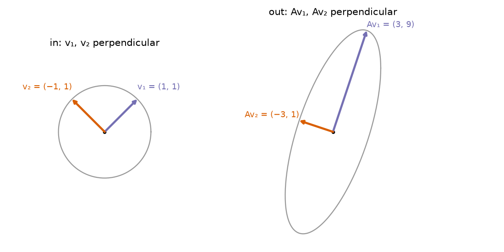
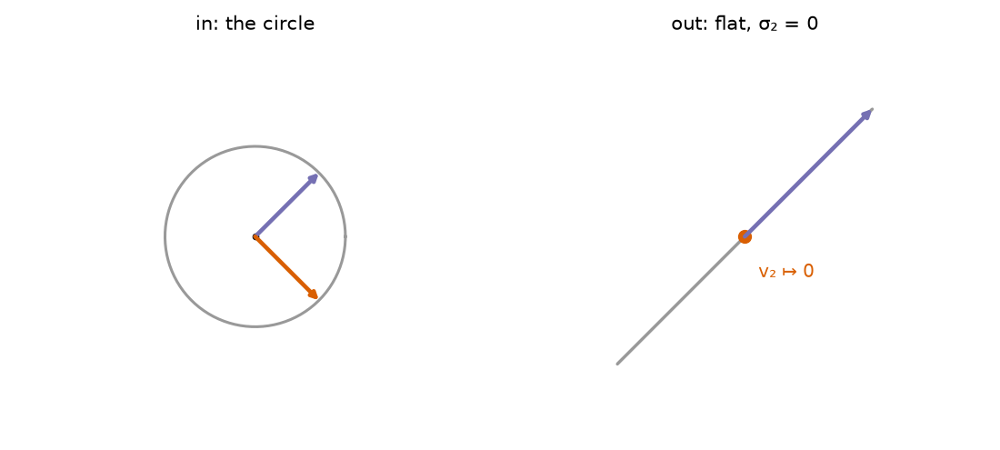
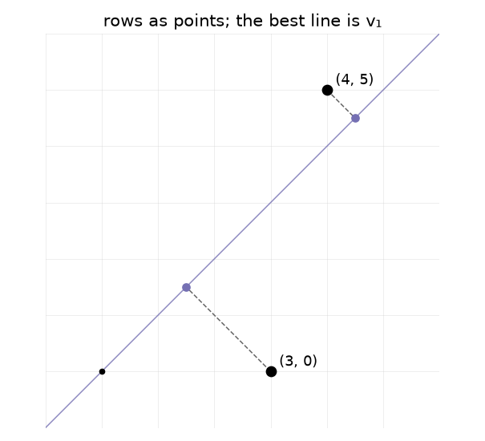

Cover the right-hand column.
Answer each question in your head, then look.

Part 3 ended with a promise:
an orthogonal basis for every matrix.
Here is one that isn't symmetric:

$$
A = \begin{pmatrix} 3 & 0 \\ 4 & 5 \end{pmatrix}
$$

## Its eigenvectors aren't enough

|                                         |                                  |
|:----------------------------------------|:---------------------------------|
| Is A symmetric? | No. Its first row is (3, 0); its first column is (3, 4). |
| What is A(0, 1)? | (0, 5). Stretched by 5, not turned. |
| What is A(1, −2)? | (3, −6). Stretched by 3, not turned. |
| So (0, 1) and (1, −2) are eigenvectors of A. Are they orthogonal? | (0, 1)·(1, −2) = −2. No. |
| Then can we find coordinates by projection? | No. Part 3's opening picture showed why. |
| And the shear S = (1 1; 0 1) from part 2? | Worse: only one line of eigenvectors. |

So we ask for less.
We don't need an arrow to keep its line.
We need two orthogonal arrows going in
that come out still orthogonal.

## Orthogonal in, orthogonal out

Drag the tip of v₁ around the circle.
v₂ stays a quarter turn ahead of it.
On the right, A sends the circle to an ellipse,
and v₁, v₂ to Av₁, Av₂.

```{ojs}
//| echo: false
A = [[3, 0], [4, 5]]
V1 = "#7570b3"   // v₁ and Av₁ (purple)
V2 = "#d95f02"   // v₂ and Av₂ (orange)
mul = (A, p) => [A[0][0] * p[0] + A[0][1] * p[1],
                 A[1][0] * p[0] + A[1][1] * p[1]]

viewof angle = {
  const S = 22, R = Math.SQRT2;                     // S px per unit
  const L = {x0: -2.5, x1: 2.5, y0: -2.5, y1: 2.5}; // the "in" panel
  const Rt = {x0: -7, x1: 7, y0: -10, y1: 10};      // the "out" panel
  const wL = (L.x1 - L.x0) * S, wR = (Rt.x1 - Rt.x0) * S;
  const W = wL + 30 + wR, H = (Rt.y1 - Rt.y0) * S;
  const pxL = p => [(p[0] - L.x0) * S, H / 2 - p[1] * S];
  const pxR = p => [wL + 30 + (p[0] - Rt.x0) * S, H / 2 - p[1] * S];
  let deg = 0;
  const svg = d3.create("svg").attr("viewBox", `0 0 ${W} ${H}`)
    .style("width", "100%").style("max-width", `${W}px`)
    .style("touch-action", "none");
  const defs = svg.append("defs");
  for (const [id, color] of [["s4a", V1], ["s4b", V2]])
    defs.append("marker").attr("id", id).attr("viewBox", "0 0 10 10")
      .attr("refX", 9).attr("refY", 5).attr("markerWidth", 5)
      .attr("markerHeight", 5).attr("orient", "auto")
      .append("path").attr("d", "M0,0L10,5L0,10z").attr("fill", color);
  const g = svg.append("g");
  const node = svg.node();
  function arrow(px, q, color, tip) {
    const [a, b] = px([0, 0]), [c, d] = px(q);
    g.append("line").attr("x1", a).attr("y1", b).attr("x2", c).attr("y2", d)
      .attr("stroke", color).attr("stroke-width", 4)
      .attr("marker-end", `url(#${tip})`);
  }
  function curve(px, pts) {
    g.append("path").attr("d", d3.line()(pts.map(px)))
      .attr("fill", "none").attr("stroke", "#999").attr("stroke-width", 1.5);
  }
  function draw() {
    g.selectAll("*").remove();
    const t = deg * Math.PI / 180;
    const v1 = [R * Math.cos(t), R * Math.sin(t)];
    const v2 = [-v1[1], v1[0]];
    const ring = d3.range(0, 361, 3).map(a => a * Math.PI / 180)
      .map(a => [R * Math.cos(a), R * Math.sin(a)]);
    curve(pxL, ring);
    curve(pxR, ring.map(p => mul(A, p)));
    arrow(pxL, v2, V2, "s4b"); arrow(pxL, v1, V1, "s4a");
    arrow(pxR, mul(A, v2), V2, "s4b"); arrow(pxR, mul(A, v1), V1, "s4a");
    const [a, b] = pxL(v1);
    g.append("circle").attr("cx", a).attr("cy", b).attr("r", 9)
      .attr("fill", V1).attr("fill-opacity", 0.3).style("cursor", "grab");
    for (const [px, p, txt, c] of [[pxL, v1, "v₁", V1], [pxL, v2, "v₂", V2],
        [pxR, mul(A, v1), "Av₁", V1], [pxR, mul(A, v2), "Av₂", V2]]) {
      const [u, w] = px(p);
      g.append("text").attr("x", u + 8).attr("y", w - 8).attr("fill", c)
        .attr("font-size", 16).text(txt);
    }
    node.value = deg;
    node.dispatchEvent(new Event("input", {bubbles: true}));
  }
  let dragging = false;
  const local = e => {
    const r = node.getBoundingClientRect();
    return [(e.clientX - r.left) * W / r.width, (e.clientY - r.top) * H / r.height];
  };
  node.addEventListener("pointerdown", e => {
    const [u, w] = local(e);
    const t = deg * Math.PI / 180;
    const [a, b] = pxL([R * Math.cos(t), R * Math.sin(t)]);
    if (Math.hypot(a - u, b - w) < 24) {
      dragging = true; node.setPointerCapture(e.pointerId);
    }
  });
  node.addEventListener("pointermove", e => {
    if (!dragging) return;
    const [u, w] = local(e), [cx, cy] = pxL([0, 0]);
    let d = Math.round(Math.atan2(cy - w, u - cx) * 180 / Math.PI / 5) * 5;
    d = (d + 360) % 360;                             // snap to 5°
    if (d !== deg) { deg = d; draw(); }
  });
  node.addEventListener("pointerup", () => { dragging = false; });
  draw();
  return node;
}
```

```{ojs}
//| echo: false
{
  const t = angle * Math.PI / 180;
  const v1 = [Math.cos(t), Math.sin(t)], v2 = [-v1[1], v1[0]];
  const a = mul(A, v1), b = mul(A, v2);
  const cos = (a[0] * b[0] + a[1] * b[1]) / Math.hypot(...a) / Math.hypot(...b);
  const between = Math.round(Math.acos(cos) * 180 / Math.PI);
  return html`<div style="font-size:1.2em; font-family:monospace">
    v₁ at ${angle}° &nbsp;→&nbsp; Av₁ and Av₂ at ${between}° to each other</div>
    <p>${between === 90
      ? html`<b>Orthogonal in, orthogonal out.</b>
        Av₁ and Av₂ lie along the ellipse's long and short axes.`
      : "Not orthogonal yet. Keep turning."}</p>`;
}
```

|                                         |                                  |
|:----------------------------------------|:---------------------------------|
| Turn v₁. Are Av₁ and Av₂ usually orthogonal? | No. |
| When are they? | With v₁ at 45°, along (1, 1), or a quarter turn from there. |
| Check without the picture: what are A(1, 1) and A(−1, 1)? | (3, 9) and (−3, 1). |
| Are those orthogonal? | (3, 9)·(−3, 1) = −9 + 9 = 0. Yes. |
| Where are they on the ellipse? | Along its long axis and its short axis. |
| How much did v₁ stretch? | ‖(3, 9)‖ = √90 and ‖(1, 1)‖ = √2. So √45, about 6.7. |
| And v₂? | ‖(−3, 1)‖ / ‖(−1, 1)‖ = √10 / √2 = √5, about 2.2. |
| What are these stretches called? | **Singular values**, σ₁ and σ₂ (σ is Greek s, "sigma"). |



## The three steps, once more

Take x = (2, 0) again.
In comes v₁ = (1, 1) and v₂ = (−1, 1);
out go u₁ along (3, 9) and u₂ along (−3, 1).

|                                         |                                  |
|:----------------------------------------|:---------------------------------|
| Step 1: x's coordinates in v's? | By projection, since the v's are orthogonal: 2/2 = 1 of v₁, −2/2 = −1 of v₂. |
| Step 2: what does A do to each basis vector? | Sends v₁ to (3, 9), and v₂ to (−3, 1). |
| Step 3: so where does x go? | 1·(3, 9) − 1·(−3, 1) = (6, 8). |
| Check the long way: A(2, 0)? | (3·2 + 0·0, 4·2 + 5·0) = (6, 8). The same. |
| In part 3, the same P turned back and turned again. Here? | Two different turns: V for the arrow going in, U for the arrow coming out. |

Make every basis vector length 1 (orthonormal), as in part 3,
and the steps become three matrices:

$$
V = \frac{1}{\sqrt2}\begin{pmatrix} {\color{#7570B3}1} & {\color{#D95F02}-1} \\ {\color{#7570B3}1} & {\color{#D95F02}1} \end{pmatrix}\qquad
\Sigma = \begin{pmatrix} \sqrt{45} & 0 \\ 0 & \sqrt5 \end{pmatrix}\qquad
U = \frac{1}{\sqrt{10}}\begin{pmatrix} {\color{#7570B3}1} & {\color{#D95F02}-3} \\ {\color{#7570B3}3} & {\color{#D95F02}1} \end{pmatrix}
$$

$$
A = U\,\Sigma\,V^{\mathsf T}
$$

|                                         |                                  |
|:----------------------------------------|:---------------------------------|
| Read right to left: what does Vᵀ do? | Projects x onto the v's: x's coordinates in v's. |
| And Σ? | Stretches each coordinate, by σ₁ and σ₂. |
| And U? | Builds the result from the u's. |
| What does Lay call the v's and the u's? | The **right** and **left singular vectors** (7.4). |
| Why insist that both bases are orthonormal? | So every coordinate, going in and coming out, is a measurement (part 3): lengths survive, and keeping the biggest σ's gives the nearest approximation. |
| How is this different from part 2's P D P⁻¹? | Two bases instead of one. |
| Does every matrix have one? | Yes, every one. Even the shear S: its v₁ leans at about 58°, and its σ's are 1.618 and 0.618. |

::: {.callout-note appearance="simple"}
## The Law of Two Bases

Every matrix sends some orthogonal arrows
to orthogonal arrows.
A = U Σ Vᵀ: project onto the v's, stretch, build with the u's.
This is the **singular value decomposition**, SVD.
:::

## Where the v's come from

We found 45° by turning v₁ until it worked.
There is a shortcut, and it uses part 3.

$$
A^{\mathsf T} A = \begin{pmatrix} 3 & 4 \\ 0 & 5 \end{pmatrix}\begin{pmatrix} 3 & 0 \\ 4 & 5 \end{pmatrix} = \begin{pmatrix} 25 & 20 \\ 20 & 25 \end{pmatrix}
$$

|                                         |                                  |
|:----------------------------------------|:---------------------------------|
| Is AᵀA symmetric? | Yes. Row 1 is (25, 20); so is column 1. |
| So what do we know about its eigenvectors? | Part 3: they are orthogonal. |
| What are they? | (1, 1), eigenvalue 45, and (−1, 1), eigenvalue 5. Our v's. |
| And 45 and 5? | σ₁² and σ₂². |

## What survives, and what's lost

|                                         |                                  |
|:----------------------------------------|:---------------------------------|
| In A = UΣVᵀ, which part changes area? | Only Σ. The turns keep area. |
| So what is det A, up to sign? | σ₁σ₂ = √45·√5 = 15. Check: 3·5 − 0·4 = 15. |
| What if a σ is 0? | That direction is flattened to 0. |



|                                         |                                  |
|:----------------------------------------|:---------------------------------|
| Take F = (1 1; 1 1). What is F(1, −1)? | (0, 0). |
| What are F's σ's? | 2 and 0. The circle goes flat, onto a segment. |
| Can any matrix undo F? | No. F sends (1, −1) and (0, 0) to the same place; nothing can tell them apart again. |
| What does Lay call the number of nonzero σ's? | The **rank** (7.4). F has rank 1. |
| And the flattened directions? | The **null space** (4.2). |

## Why anyone bothers: the best line

Part 3 ended with the nearest point:
in an orthonormal basis, keeping one coordinate gives the projection,
as close as that direction can get.
Now we choose the direction.

Read A's rows as two points, (3, 0) and (4, 5).



|                                         |                                  |
|:----------------------------------------|:---------------------------------|
| For a length-1 arrow v, what are the two numbers in Av? | Row 1 dotted with v, and row 2 dotted with v: each point's projection onto v's line, as a signed length. |
| Which v makes Av longest? | v₁. A stretches it most: the long axis of the ellipse. |
| So which line gets the longest projections? | The one along v₁ = (1, 1). |
| Why is that the line closest to the points? | Each point's length is fixed. Projection² + distance² = length², so the longer the projection, the shorter the distance. |
| And with a thousand rows? | The same: v₁ is the line through the origin that passes closest to all of them. |

::: {.callout-note appearance="simple"}
## The Law of the Best Line

A's first in-arrow v₁ is the line
that passes closest to A's rows.
:::

Make each row a photo of a face,
and v₁, v₂, … become the "eigenfaces"
that most faces are mostly made of.
That story is told in the
[SVD comic](https://nealch.gumroad.com),
which follows Hopcroft and Kannan
from best fit to principal components.

## In Lay

Section and example numbers from [[Lay16]](linalg1-same-arrow.qmd#references).

| Here | Lay |
|:-----|:----|
| v₁, v₂, going in | right singular vectors (7.4) |
| u₁, u₂, coming out | left singular vectors (7.4) |
| the stretches σ | singular values: square roots of the eigenvalues of AᵀA (7.4) |
| A = U Σ Vᵀ | the singular value decomposition (7.4) |
| circle to ellipse; v₁ stretched most | 7.4, Example 1; the largest ‖Ax‖ for unit x (7.3) |
| \|det A\| = σ₁σ₂ | the determinant as area (3.3) |
| the number of nonzero σ's | rank, 7.4 Theorem 9 |
| the flattened directions | the null space, Nul A (4.2) |
| the best line through the rows | principal components (7.5) |
