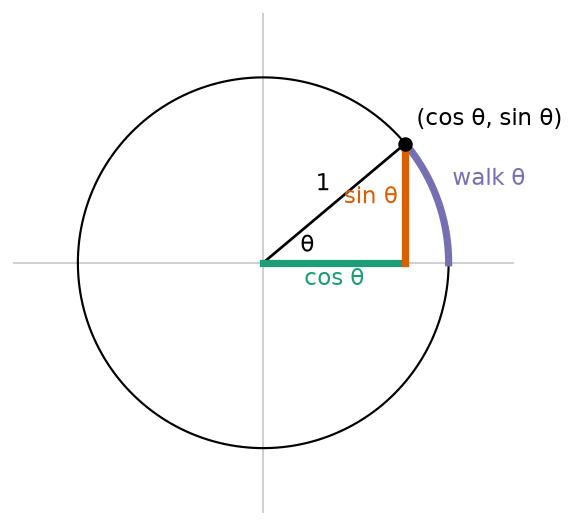
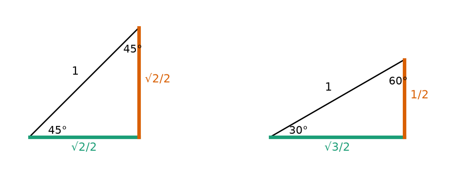
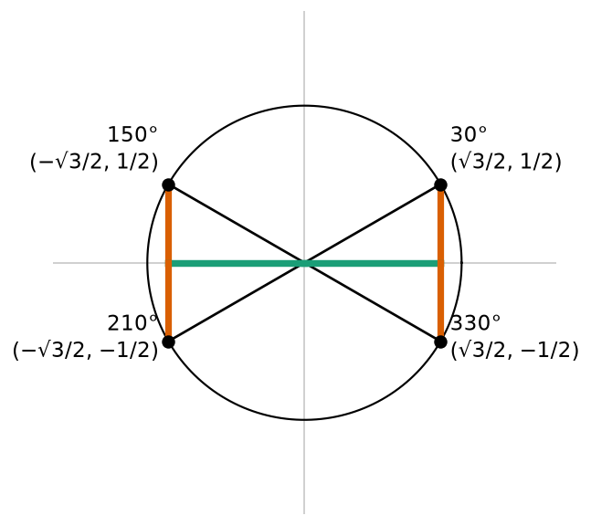

Cover the right-hand column.
Answer each question in your head, then look.

## An angle is a walk

|                                         |                                  |
|:----------------------------------------|:---------------------------------|
| A circle has radius 1. Walk once round it. How far did you go? | 2π, its circumference. |
| Half way round? | π. |
| How many degrees is half a turn? | 180°. |
| So what is an angle? | How far you walked round the circle. Degrees count 360 to a turn; **radians** count the distance itself, 2π to a turn. |
| A quarter turn, in radians? | 2π ÷ 4 = π/2. |
| π/3, in degrees? | π is 180°, so π/3 is 60°. |
| 135°, in radians? | 135 is three quarters of 180, so 3π/4. |

::: {.callout-note appearance="simple"}
## The Law of Radians

π radians = 180°.
To get radians, multiply degrees by π/180;
to get degrees, multiply radians by 180/π.
:::

## Where the walk ends

Start at (1, 0) and walk θ round the circle, anticlockwise.

{width=55%}

|                                         |                                  |
|:----------------------------------------|:---------------------------------|
| Where are you now? | At some point (x, y) on the circle. |
| What is x called? | **cos θ**: how far across. |
| And y? | **sin θ**: how far up. |
| What is tan θ? | sin θ ÷ cos θ: up over across, the slope of your radius. |

::: {.callout-note appearance="simple"}
## The Law of the Point

The point at angle θ on the circle of radius 1 is (cos θ, sin θ).
:::

A bigger circle is the same picture, scaled.
That is all a right triangle is.

|                                         |                                  |
|:----------------------------------------|:---------------------------------|
| A 4 m ladder leans at 60° to the ground. Which circle is it the radius of? | The circle of radius 4. |
| How high does it reach? | 4 times as high as on the unit circle: 4 sin 60°. |
| A ramp 2 m long rises 1 m. Which angle has sin θ = 1/2? | We need a few values we know by heart. Next section. |

## Two triangles worth knowing

|                                         |                                  |
|:----------------------------------------|:---------------------------------|
| Cut a square along its diagonal. The angles? | 45°, 45°, 90°. |
| Make the diagonal 1. How long are the two equal sides, x? | x² + x² = 1, so x = 1/√2 = √2/2. |
| So cos 45° and sin 45°? | Both √2/2. |
| Cut an equilateral triangle with sides 1 in half. The angles? | 30°, 60°, 90°. |
| The short side? | Half of 1: 1/2. That's sin 30°. |
| The long side? | √(1 − 1/4) = √3/2. That's cos 30°. |
| Back to the ramp: the angle? | sin θ = 1/2, so θ = 30°. |
| And the ladder: 4 sin 60°? | Turn the 30-60-90 triangle round: sin 60° = √3/2. The ladder reaches 4 · √3/2 = 2√3 ≈ 3.46 m. |

## Same reference angle, same numbers

{width=60%}

|                                         |                                  |
|:----------------------------------------|:---------------------------------|
| Where is 150°? | 30° short of half a turn: 30° mirrored across the up-down axis. |
| So sin 150°? | The same height as 30°: 1/2. |
| And cos 150°? | The same distance across, but to the left: −√3/2. |
| What is 30° called here? | The **reference angle**: the angle between your radius and the nearest x-axis. |
| The reference angle of 225°? | 225 − 180 = 45°. |
| Of 300°? | 360 − 300 = 60°. |

::: {.callout-note appearance="simple"}
## The Law of Reference Angles

An angle has the same sin and cos as its reference angle,
except for the sign.
The quadrant sets the sign:
across is negative on the left,
up is negative below.
:::

Someone writes sin 210° = 1/2.
Find the mistake.

Decide before you read on.

210° is 30° past half a turn, below the axis.
Below means up is negative: sin 210° = −1/2.

## The other three

|                                         |                                  |
|:----------------------------------------|:---------------------------------|
| **sec θ**? | 1 ÷ cos θ. |
| **csc θ**? | 1 ÷ sin θ. |
| **cot θ**? | 1 ÷ tan θ, which is cos θ ÷ sin θ. |
| sec 60°? | cos 60° = 1/2, so sec 60° = 2. |
| tan 90°? | At 90° you are at (0, 1). cos 90° = 0, and we can't divide by 0. No value. |

The names cross over:
sec goes with cos, csc with sin.
If that won't stick, remember only "one over".

## Exercises

Click Answer under an exercise to see it.

1. Turn 90° into radians, and π/3 into degrees.

   

Answer

   π/2; 60°.

   

2. Turn 135° into radians, and 5π/6 into degrees.

   

Answer

   3π/4; 150°.

   

3. Draw the point first, then give sin 210° and cos 120°.

   

Answer

   210° is below the axis on the left: sin 210° = −1/2.
   120° is up and to the left: cos 120° = −1/2.

   

4. csc(π/4) and cot 150°.

   

Answer

   π/4 is 45°, sin 45° = √2/2, so csc(π/4) = 2/√2 = √2.
   cot 150° = cos 150° ÷ sin 150° = (−√3/2) ÷ (1/2) = −√3.

   

5. The reference angles of 225° and 300°.

   

Answer

   45° and 60°.

   

6. A 10 m ramp rises at 30°. How high does it go?

   

Answer

   10 sin 30° = 10 · 1/2 = 5 m.

   

7. A 2 m pole leans against a wall; its top is √2 m up. At what angle does it lean?

   

Answer

   sin θ = √2/2, so θ = 45°.

   

