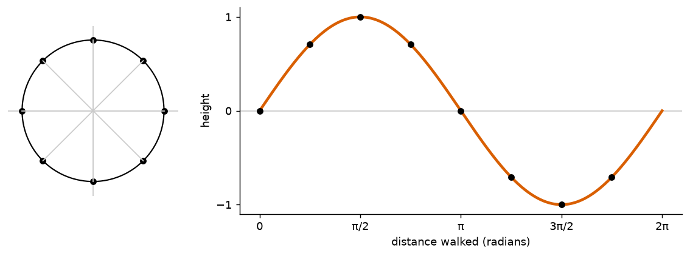
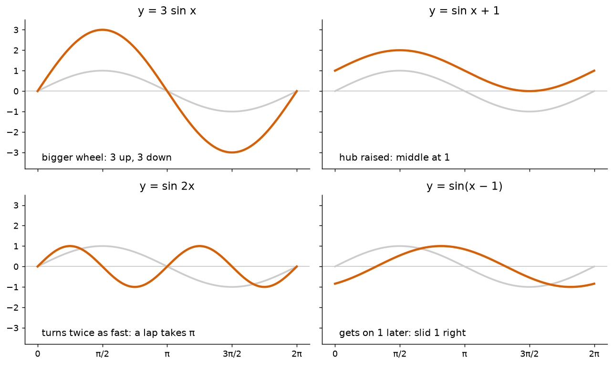
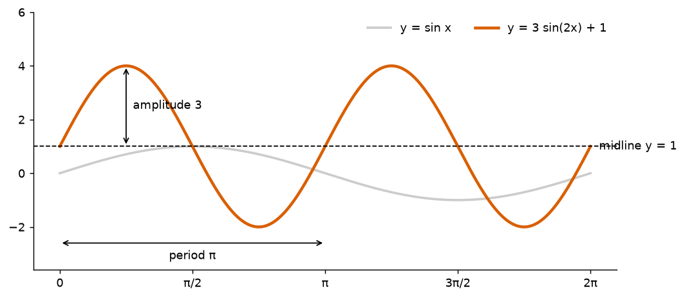
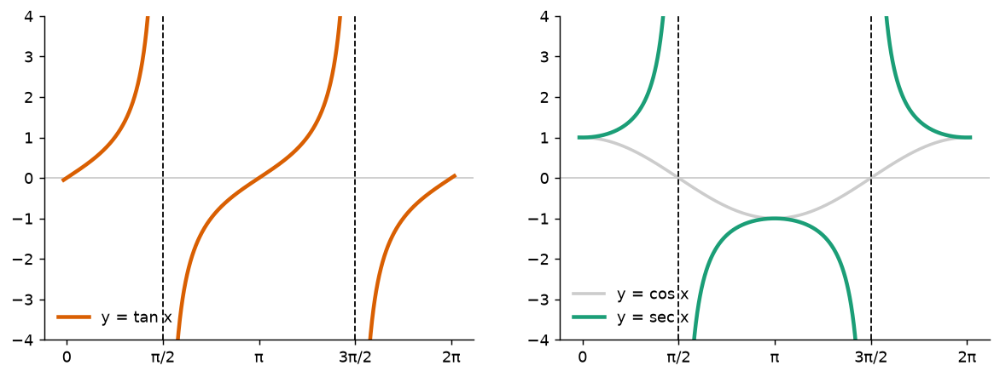
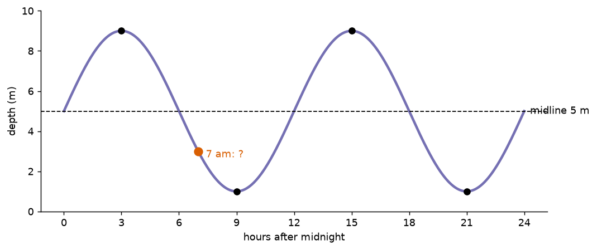

Cover the right-hand column.
Answer each question in your head, then look.

## Unrolling the circle

Walk round the circle of
[part 1](trig1-point-on-circle.qmd),
and keep track of your height.



|                                         |                                  |
|:----------------------------------------|:---------------------------------|
| Your height when you start? | 0. |
| After a quarter turn, π/2? | 1, the top. |
| At π? | 0 again. |
| At 3π/2? | −1, the bottom. |
| At 2π? | 0, and it all starts over. |
| Draw height against distance walked. What shape? | The sine wave. |
| And the graph of cos? | The same wave, made from how far across you are. It starts at the top, 1: it is sin slid left by π/2. |

Move the slider.
The purple walk round the circle
is laid flat along the bottom of the wave, at the same scale:
the wave is the circle unrolled.

```{ojs}
//| echo: false
viewof walk = Inputs.range([0, 2 * Math.PI],
  {value: Math.PI / 3, step: 0.01, label: "walk x"})
```

```{ojs}
//| echo: false
{
  // Same colours as the figures: walk purple, height (sin) orange.
  const WALK = "#7570b3", SIN = "#d95f02", GREY = "#cccccc";
  const R = 60;                        // circle radius in px = 1 unit
  const cx = 75, cy = 85;              // circle centre
  const x0 = cx + R + 40;              // where the wave starts
  // one radian is R px on both sides, so the flat walk is the arc's length
  const wx = t => x0 + R * t, wy = t => cy - R * Math.sin(t);
  const W = x0 + 2 * Math.PI * R + 20;
  const px = cx + R * Math.cos(walk), py = wy(walk);
  const line = d3.line();
  const ts = (a, b) => d3.range(a, b, 0.02).concat([b]);
  const arc = ts(0, walk).map(t => [cx + R * Math.cos(t), wy(t)]);
  const wave = ts(0, 2 * Math.PI).map(t => [wx(t), wy(t)]);
  const done = ts(0, walk).map(t => [wx(t), wy(t)]);
  const ticks = [[0, "0"], [Math.PI / 2, "π/2"], [Math.PI, "π"],
                 [3 * Math.PI / 2, "3π/2"], [2 * Math.PI, "2π"]];
  return htl.svg`<svg viewBox="0 0 ${W} ${cy + R + 25}"
      style="width:100%;max-width:${W}px;font:13px sans-serif">
    <line x1=${cx - R - 10} y1=${cy} x2=${cx + R + 10} y2=${cy} stroke=${GREY}></line>
    <line x1=${cx} y1=${cy - R - 10} x2=${cx} y2=${cy + R + 10} stroke=${GREY}></line>
    <line x1=${x0} y1=${cy} x2=${wx(2 * Math.PI)} y2=${cy} stroke=${GREY}></line>
    <circle cx=${cx} cy=${cy} r=${R} fill="none" stroke="black"></circle>
    <path d=${line(wave)} fill="none" stroke=${GREY} stroke-width="2"></path>
    <path d=${line(arc)} fill="none" stroke=${WALK} stroke-width="5"></path>
    <line x1=${x0} y1=${cy} x2=${wx(walk)} y2=${cy}
          stroke=${WALK} stroke-width="5"></line>
    <path d=${line(done)} fill="none" stroke=${SIN} stroke-width="2.5"></path>
    <line x1=${cx} y1=${cy} x2=${px} y2=${py} stroke="black"></line>
    <line x1=${px} y1=${cy} x2=${px} y2=${py} stroke=${SIN} stroke-width="4"></line>
    <line x1=${wx(walk)} y1=${cy} x2=${wx(walk)} y2=${py}
          stroke=${SIN} stroke-width="4"></line>
    <line x1=${px} y1=${py} x2=${wx(walk)} y2=${py}
          stroke="#999" stroke-dasharray="4 3"></line>
    <circle cx=${px} cy=${py} r="5"></circle>
    <circle cx=${wx(walk)} cy=${py} r="5"></circle>
    ${ticks.map(([t, s]) => htl.svg`<g>
      <line x1=${wx(t)} y1=${cy - 4} x2=${wx(t)} y2=${cy + 4}
            stroke="#555"></line>
      <text x=${wx(t)} y=${cy + R + 18}
            text-anchor="middle" fill="#555">${s}</text></g>`)}
  </svg>`;
}
```

```{ojs}
//| echo: false
md`Walked x = ${walk.toFixed(2)} (that's ${Math.round(walk * 180 / Math.PI)}°);
height sin x = ${Math.sin(walk).toFixed(2)}.`
```

::: {.callout-note appearance="simple"}
## The Law of the Wave

The graph of sin is the height of the point after walking x.
It repeats every 2π, the length of one walk round.
:::

## Four dials

Ride a Ferris wheel.
Your height, as the wheel turns, is a sine wave:
the circle of part 1, stood on its edge.
Change the wheel, and the wave changes with it.
There are only a few things to change.



|                                         |                                  |
|:----------------------------------------|:---------------------------------|
| The wheel has radius 3 instead of 1. How far above the hub do you go? | 3, and 3 below it. Every height is 3 times as big: y = 3 sin x. |
| What is that 3 called? | The **amplitude**: how far the wave goes above and below its middle. |
| The hub is raised 1. What happens to every height? | It goes up 1: y = sin x + 1. |
| Where is the middle of the wave now? | At y = 1, the hub's height. That line is the **midline**. |
| The wheel turns twice as fast. How long does one lap take? | Half as long: π instead of 2π. y = sin 2x repeats every π. |
| What is the length of one lap called? | The **period**. |
| Why does a bigger number mean a shorter period? | Turning B times as fast fits B laps into 2π, so one lap takes 2π/B. |
| You get on 1 later. What happens to the wave? | Everything happens 1 later: the wave slides 1 to the right. y = sin(x − 1). |
| Why minus, if it moves right? | You start your ride when x − 1 = 0, that is, at x = 1. The start has moved from 0 to 1. |

Now turn the dials yourself.
The grey wave is y = sin x, for comparison.

```{ojs}
//| echo: false
viewof A = Inputs.range([0.5, 3], {value: 2, step: 0.5, label: "A: wheel radius"})
viewof k = Inputs.range([-2, 2], {value: 1, step: 0.5, label: "k: hub height"})
viewof B = Inputs.range([0.5, 3], {value: 1, step: 0.5, label: "B: how fast"})
viewof h = Inputs.range([0, 3], {value: 0, step: 0.25, label: "h: get on later"})
```

```{ojs}
//| echo: false
{
  const SIN = "#d95f02", GREY = "#cccccc";
  const W = 560, x0 = 40, sx = (W - x0 - 20) / (2 * Math.PI);
  const top = 5.5, bottom = -5, sy = 22, y0 = 15;
  const H = y0 + (top - bottom) * sy + 25;
  const X = x => x0 + sx * x, Y = y => y0 + (top - y) * sy;
  const xs = d3.range(0, 2 * Math.PI, 0.01).concat([2 * Math.PI]);
  const line = d3.line();
  const grey = line(xs.map(x => [X(x), Y(Math.sin(x))]));
  const wave = line(xs.map(x => [X(x), Y(A * Math.sin(B * (x - h)) + k)]));
  const ticks = [[0, "0"], [Math.PI / 2, "π/2"], [Math.PI, "π"],
                 [3 * Math.PI / 2, "3π/2"], [2 * Math.PI, "2π"]];
  const yticks = [-4, -2, 0, 2, 4];
  return htl.svg`<svg viewBox="0 0 ${W} ${H}"
      style="width:100%;max-width:${W}px;font:13px sans-serif">
    <line x1=${X(0)} y1=${Y(0)} x2=${X(2 * Math.PI)} y2=${Y(0)} stroke=${GREY}></line>
    <line x1=${X(0)} y1=${Y(top)} x2=${X(0)} y2=${Y(bottom)} stroke=${GREY}></line>
    <path d=${grey} fill="none" stroke=${GREY} stroke-width="2"></path>
    <line x1=${X(0)} y1=${Y(k)} x2=${X(2 * Math.PI)} y2=${Y(k)}
          stroke="black" stroke-dasharray="5 4"></line>
    <line x1=${X(0.15)} y1=${Y(k)} x2=${X(0.15)} y2=${Y(k + A)}
          stroke="black"></line>
    <path d=${wave} fill="none" stroke=${SIN} stroke-width="2.5"></path>
    ${ticks.map(([t, s]) => htl.svg`<text x=${X(t)} y=${H - 5}
        text-anchor="middle" fill="#555">${s}</text>`)}
    ${yticks.map(v => htl.svg`<text x=${x0 - 8} y=${Y(v) + 4}
        text-anchor="end" fill="#555">${v}</text>`)}
  </svg>`;
}
```

```{ojs}
//| echo: false
md`y = ${A} sin(${B}(x − ${h})) + ${k}:
amplitude ${A}, midline y = ${k}, period 2π/${B} ≈ ${(2 * Math.PI / B).toFixed(2)},
slid ${h} to the right.
Highest ${k + A}, lowest ${k - A}.`
```

All three at once:



|                                         |                                  |
|:----------------------------------------|:---------------------------------|
| y = 3 sin(2x) + 1: which wheel? | Radius 3, hub at 1, turning twice as fast. |
| Highest and lowest? | The hub plus or minus the radius: from 1 − 3 = −2 up to 1 + 3 = 4. |
| Its period? | 2π ÷ 2 = π. |

::: {.callout-note appearance="simple"}
## The Law of the Dials

y = A sin(B(x − h)) + k
is a wheel of radius |A| with its hub at height k,
turning B times as fast, boarded h late:
amplitude |A|, midline y = k, period 2π/B,
slid h to the right.
The same holds for cos.
:::

## Where graphs break



|                                         |                                  |
|:----------------------------------------|:---------------------------------|
| tan x = sin x ÷ cos x. What happens where cos x = 0? | We'd divide by 0: no value. Near there, tan shoots off up or down. |
| Where is cos x = 0? | At π/2 and 3π/2: straight up and straight down. |
| The dashed lines there are called? | **Vertical asymptotes**: lines the graph never reaches. |
| sec x = 1 ÷ cos x. Where does it break? | In the same places. |
| Where cos x is 1, sec x is? | 1. Where cos is at its top, sec is at its bottom: each piece is a U. |
| csc x and cot x? | Both divide by sin x, so they break where sin x = 0: at 0, π, 2π. |
| Why does tan repeat every π, not 2π? | It's the slope of your radius. Half a turn later the radius points the other way along the same line, with the same slope. |

The whole table, for 0 ≤ x ≤ 2π.
Each one breaks where the thing it divides by is 0.

| | zeros | breaks | period | values |
|:--|:--|:--|:--|:--|
| sin | 0, π, 2π | none | 2π | −1 to 1 |
| cos | π/2, 3π/2 | none | 2π | −1 to 1 |
| tan | 0, π, 2π | π/2, 3π/2 | π | all |
| csc | none | 0, π, 2π | 2π | ≤ −1 or ≥ 1 |
| sec | none | π/2, 3π/2 | 2π | ≤ −1 or ≥ 1 |
| cot | π/2, 3π/2 | 0, π, 2π | π | all |

## The tides



A harbour: high tide is 9 m deep at 3 am,
low tide 1 m at 9 am,
high again at 3 pm.

|                                         |                                  |
|:----------------------------------------|:---------------------------------|
| The midline? | Halfway between 9 and 1: 5 m. |
| The amplitude? | From the midline to the top: 9 − 5 = 4 m. |
| The period? | High tide to high tide: 12 hours. |
| So B? | Period = 2π/B, so B = 2π/12 = π/6. |
| sin or cos? | cos starts at its top. High tide is at 3, so slide cos right by 3. |
| The model? | depth = 5 + 4 cos(π/6 · (t − 3)), t in hours after midnight. |
| How deep at 7 am? | 5 + 4 cos(π/6 · 4) = 5 + 4 cos(2π/3). |

Decide before you read on.

2π/3 is 120°, and cos 120° = −1/2 (part 1).
So the depth is 5 + 4 · (−1/2) = 3 m.

Someone writes the model as 5 + 4 cos(12(t − 3)).
Find the bug.

Decide before you read on.

12 is the period, not B.
B is 2π/12 = π/6.

## Exercises

Click Answer under an exercise to see it.

1. y = 2 sin(3x) − 1. Give the amplitude, period, midline,
   highest and lowest values.

   <details><summary>Answer</summary>

   Amplitude 2, period 2π/3, midline y = −1;
   highest −1 + 2 = 1, lowest −1 − 2 = −3.

   </details>

2. Sketch y = cos x + 2 from 0 to 2π.
   Mark its midline, its top and its bottom.

   <details><summary>Answer</summary>

   Midline y = 2. Top 3 at x = 0 and 2π;
   bottom 1 at x = π.

   </details>

3. Where does csc x break between 0 and 2π?
   Where is tan x zero?

   <details><summary>Answer</summary>

   csc breaks where sin x = 0: 0, π, 2π.
   tan x = sin x ÷ cos x is zero where sin x is: also 0, π, 2π.

   </details>

4. In the harbour, how deep is it at 9 am?
   At which four times of day is it exactly 5 m deep?

   <details><summary>Answer</summary>

   1 m (low tide).
   5 m is the midline, crossed halfway between high and low:
   midnight, 6 am, noon and 6 pm.

   </details>
