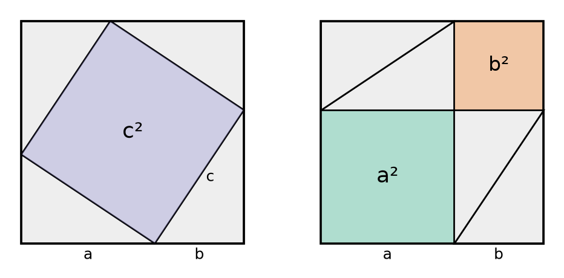
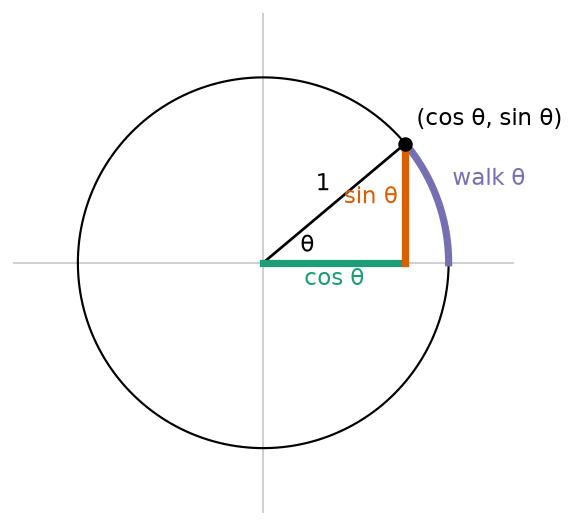
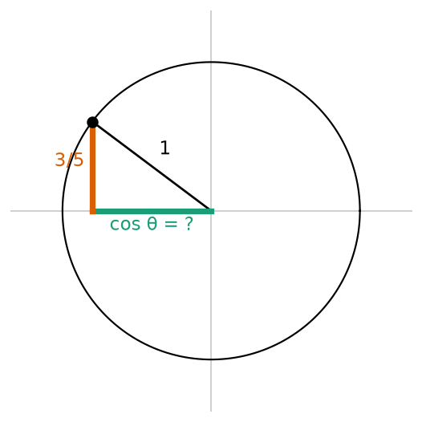

Cover the right-hand column.
Answer each question in your head, then look.

## First, why Pythagoras is true

The proof rests on Pythagoras,
so recall why it holds.
A right triangle has legs a and b and long side c.

|                                         |                                  |
|:----------------------------------------|:---------------------------------|
| On the left, four copies of the triangle sit in a square of side a + b. What is left over in the middle? | A tilted square, c by c: area c². |
| On the right, the same four triangles are moved into two pairs. What is left over now? | Two squares: a by a and b by b. Area a² + b². |
| The big square is the same, and so are the four triangles. So? | The leftovers have the same area: a² + b² = c². |

Nothing was measured; the triangles only moved.

## The proof

{width=55%}

It takes two steps.

|                                         |                                  |
|:----------------------------------------|:---------------------------------|
| Step 1. What are cos θ and sin θ? | By definition (part 1), the point at θ on the circle of radius 1 is (cos θ, sin θ). |
| Step 2. The triangle's legs and long side? | cos θ across, sin θ up, and the radius, 1. |
| What does Pythagoras say? | cos²θ + sin²θ = 1. |
| What does sin²θ mean? | (sin θ)², the number sin θ squared. Not sin(θ²). |
| Does it only work in the first quadrant? | No. On the left cos θ is negative, but its square isn't. Every point on the circle works. |
| At 0° or 90° there is no triangle. | The point is still 1 from the centre: (1, 0) or (0, 1). 1² + 0² = 1. |

That is the whole proof:
the definition, then Pythagoras.

::: {.callout-note appearance="simple"}
## The Pythagorean Identity

sin²θ + cos²θ = 1, for every angle θ.
It is Pythagoras on the circle of radius 1.
:::

Check it with part 1's triangle at 30°:
(1/2)² + (√3/2)² = 1/4 + 3/4 = 1.

## Using it

{width=55%}

|                                         |                                  |
|:----------------------------------------|:---------------------------------|
| sin θ = 3/5, and θ is in quadrant II. What is cos²θ? | 1 − (3/5)² = 1 − 9/25 = 16/25. |
| So cos θ? | √(16/25) = 4/5, or −4/5. |
| Which one? | Quadrant II is on the left, where across is negative: −4/5. |
| tan θ? | sin ÷ cos = (3/5) ÷ (−4/5) = −3/4. |
| Why did we need the quadrant? | The identity gives cos², and squaring hides the sign. The picture puts it back. |

Someone writes:
"sin θ = 0.6, so cos θ = 0.4, because they add to 1."
Find the mistake.

Decide before you read on.

The squares add to 1, not the numbers.
0.6² = 0.36, so cos²θ = 0.64,
and cos θ = 0.8 (in quadrant I).

## Simplifying

The identity is a swap:
1 can become sin² + cos², and back.

|                                         |                                  |
|:----------------------------------------|:---------------------------------|
| Simplify 1 − cos²θ. | sin²θ. |
| Simplify (1 − sin²θ) ÷ cos θ. | cos²θ ÷ cos θ = cos θ. |
| Divide sin²θ + cos²θ = 1 by cos²θ. What do you get? | tan²θ + 1 = sec²θ: a second identity, free. |

## Exercises

Click Answer under an exercise to see it.

1. cos θ = 5/13, and θ is in quadrant IV. Find sin θ and tan θ.

   

Answer

   sin²θ = 1 − 25/169 = 144/169. Quadrant IV is below, so
   sin θ = −12/13, and tan θ = (−12/13) ÷ (5/13) = −12/5.

   

2. cos θ = −0.6, and θ is in quadrant III. Find sin θ and tan θ.

   

Answer

   sin²θ = 1 − 0.36 = 0.64. Quadrant III is below, so
   sin θ = −0.8, and tan θ = −0.8 ÷ −0.6 = 4/3.

   

3. Simplify:

   a. sin²θ + cos²θ + tan²θ
   b. cos θ · tan θ
   c. 1 ÷ cos²θ − 1

   

Answer

   a. 1 + tan²θ = sec²θ.
   b. cos θ · (sin θ ÷ cos θ) = sin θ.
   c. sec²θ − 1 = tan²θ.

   

4. Check the identity at 45° with part 1's other triangle.

   

Answer

   (√2/2)² + (√2/2)² = 2/4 + 2/4 = 1.

   

## The unit on one page

- An angle is a walk round the circle of radius 1;
  π radians = 180°.
- The walk ends at (cos θ, sin θ);
  tan = sin ÷ cos, and sec, csc, cot are one over cos, sin, tan.
- The reference angle gives the numbers; the quadrant gives the sign.
- The graphs are heights and distances across, drawn against the walk;
  y = A sin(B(x − h)) + k has amplitude |A|, period 2π/B, midline k.
- A graph breaks where the thing it divides by is 0.
- sin²θ + cos²θ = 1: Pythagoras on the circle.
